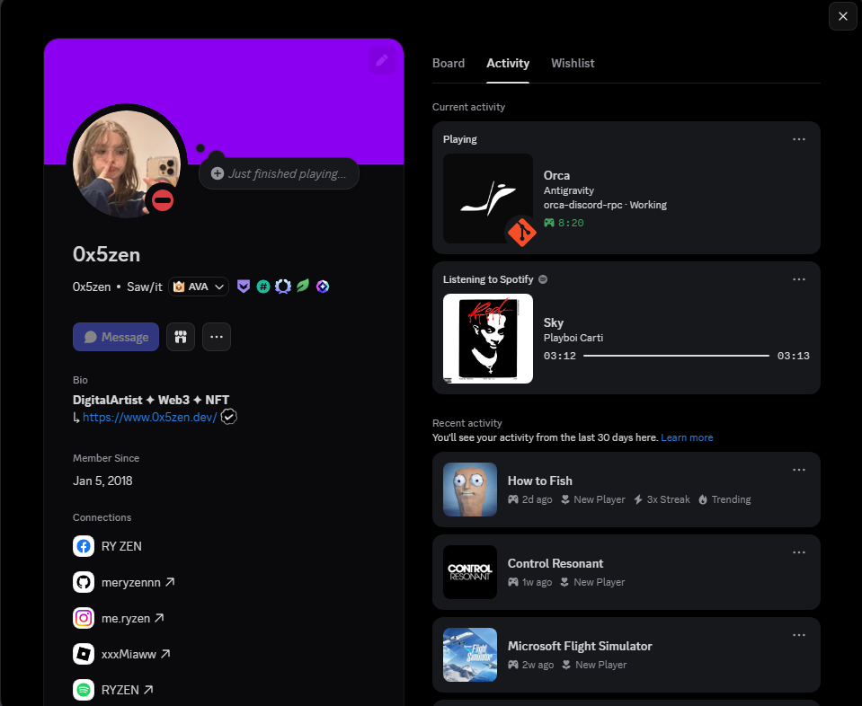

<div align="center">

# orca-discord-rpc


### Discord Rich Presence for [Orca](https://github.com/stablyai/orca)
Shows your active Orca workspace and the agent you are working with on your Discord profile.

[](https://github.com/meryzennn/orca-discord-rpc/releases/latest)
[](LICENSE)

</div>

---

## Discord profile preview

<p align="center">
  
</p>

This screenshot shows the layout from before v0.1.7. The first line now reads `Agent: Antigravity · Working` and the second `Folder: orca-discord-rpc`. The current layout is in [What Discord shows](#what-discord-shows).

---

## Features

- Shows the featured agent, how many other agents are open, the workspace folder, whether the agent is working or idle, and a session timer.
- Adds a View Repository button that opens the workspace's `origin` remote in the browser.
- Incognito Mode replaces the folder with `Private Project`, hides the branch and the repository button, and shows the agent's icon instead. Hovering the icon shows the model, such as `Claude Opus 5.5`.
- Runs from any folder with no installer. The exe is never copied anywhere; only `config.json` and `tray.log` are written, to `%LOCALAPPDATA%\orca-discord-rpc`.
- Checks GitHub for a new release 5 seconds after start, then every 30 minutes. When one exists, the tray icon gets a red dot, and one click downloads it, replaces the files and restarts the app.
- Only one copy runs at a time. A second launch shows a message and exits, so two copies never fight over your profile.

---

## Install (Windows)

1. Download `OrcaPresence-windows.zip` from the [latest release](https://github.com/meryzennn/orca-discord-rpc/releases/latest).
2. Extract it anywhere, for example `C:\Tools\OrcaPresence`, and double-click `OrcaPresence.exe`.
3. The app runs in the system tray. To launch it at login, right-click the tray icon and tick Start with Windows.

To uninstall, untick Start with Windows and delete the folder. Settings and logs stay in `%LOCALAPPDATA%\orca-discord-rpc` until you delete that folder as well.

### Command line

Autostart can also be set from PowerShell or Command Prompt:

```sh
OrcaPresence.exe autostart enable    # start at login, pointing at this exe
OrcaPresence.exe autostart disable   # stop starting at login
OrcaPresence.exe autostart status    # show the current entry
```

The entry lives under `HKEY_CURRENT_USER`, so no administrator rights are needed.

---

## Requirements

- Orca, with the `orca` CLI on `PATH`.
- The Discord desktop app, running and logged in. Discord in a browser has no local IPC socket, so it cannot show Rich Presence.
- Windows 10 or 11. The app runs on .NET Framework 4.8, which ships with Windows 10 (May 2019 Update and later) and Windows 11, so there is nothing else to install.
- Node.js 24+, only if you run the headless daemon on macOS or Linux.

---

## What Discord shows

| Field | Normal | Incognito |
| --- | --- | --- |
| Line 1 | `Agent: Claude +1 · Working` | Same |
| Line 2 | `Folder: orca-discord-rpc` | `Folder: Private Project` |
| Timer | Time since the session started | Same |
| Small icon | Branch icon; hovering shows the branch name | Agent icon; hovering shows the model, such as `Claude Opus 5.5` |
| Button | View Repository, when the workspace has an `origin` remote | None |

With no agent open, line 1 reads `Using Orca` and line 2 shows the folder.

How each value is chosen:

- The featured agent is the one that most recently changed state. A working agent wins over an idle one, so the busier session is the one people see. `+1` counts the other open agent panes.
- The folder comes from the workspace path. A workspace you renamed in Orca keeps its name.
- Orca does not report which model an agent runs, so the app reads it from the agent's own session log: Claude Code from `%USERPROFILE%\.claude\projects` (or `CLAUDE_CONFIG_DIR`), Codex from `%USERPROFILE%\.codex\sessions` (or `CODEX_HOME`). When two sessions share one workspace, the one that wrote most recently wins. Other agents, or a missing log, fall back to `Agent: <name>`.
- The timer keeps running when you switch workspace or agent, and resets when Orca closes or no workspace is active.

---

## Tray menu

Right-click the tray icon. The second row shows the current status:

| Status row | Meaning |
| --- | --- |
| `Agent: Claude · Working` | Everything works; this is what your profile shows |
| `Using Orca` | Orca is open but no agent is running |
| `Discord not detected` | Orca is open but Discord is not; a Reconnect to Discord row appears |
| `Orca is not running` | Waiting for Orca to open |
| `Presence paused` | You turned presence off; choose Enable presence to turn it back on |
| `Problem` | The last update failed; the tray tooltip names the reason |

The other rows, top to bottom:

- Update to vX.Y.Z (Click to auto-update), only when a new release is waiting
- Disable presence, or Enable presence while paused
- Application id, for reference
- Incognito Mode
- Start with Windows
- Check for updates..., when no update is waiting
- Star on GitHub, which opens this repository
- Quit

---

## Size and memory

| | Tray app (C#) | Headless daemon (Node) | Electron app (retired) |
| --- | --- | --- | --- |
| Download | 1.7 MB folder, 611 KB exe | 36 MB `node_modules`, dev tools included | 106 MB installer |
| Memory | 13.8 MB working set, 34 MB private | Not measured | 224 MB |
| Processes | 1 | 1 | 3 |

The tray app's memory was measured with `Get-Process` on one machine on 2026-10-11. Every 5 minutes the app calls `SetProcessWorkingSetSize`, which lowers the working set Task Manager shows; the private memory it holds stays the same.

---

## Configuration

The app works with no setup, because a Discord application id is built in. To use your own application, uploaded art, or Incognito by default, set environment variables:

```sh
setx ORCA_DISCORD_CLIENT_ID "123456789012345678"
setx ORCA_DISCORD_UPLOADED_ART "1"
setx ORCA_DISCORD_INCOGNITO "1"
```

or edit `%LOCALAPPDATA%\orca-discord-rpc\config.json`:

```json
{
  "clientId": "123456789012345678",
  "pollMs": 15000,
  "useUploadedArt": true,
  "incognito": false
}
```

Environment variables win over the file. The Incognito Mode row in the tray menu writes `incognito` to this file. A `pollMs` under 5000 is ignored and the 15 second default is used instead, which stays inside Discord's limit of about 5 updates per 20 seconds.

---

## Build and development

### Windows tray app

```sh
npm run build:csharp                    # build the icon and publish to dist-csharp
npm run pack:csharp                     # zip dist-csharp into OrcaPresence-windows.zip
dotnet test csharp/OrcaPresence.Tests   # run the tests
```

### Headless daemon (macOS, Linux, or scripted use)

```sh
npm install
npm start          # start the daemon, logging to daemon.log
npm test           # run the tests
npm run typecheck
```

---

## How it works

```
orca worktree ps --json ──► parse ──► select the active worktree
                                            │
                       folder + open agents ──► dedup by payload
                                            │
                 hand-rolled Discord IPC ──► the local named pipe
```

- The tray app talks to Discord over its local named pipe, `\\.\pipe\discord-ipc-0`, without a Discord SDK.
- It runs `orca worktree ps --json` every 15 seconds by default, and sends Discord an update only when what it would show has changed.
- When Discord or Orca restarts, the next poll reconnects and sends the current state again.
- Errors go to `tray.log` (tray app) or `daemon.log` (daemon) instead of popping up.

---

## License

MIT. See [LICENSE](LICENSE).
