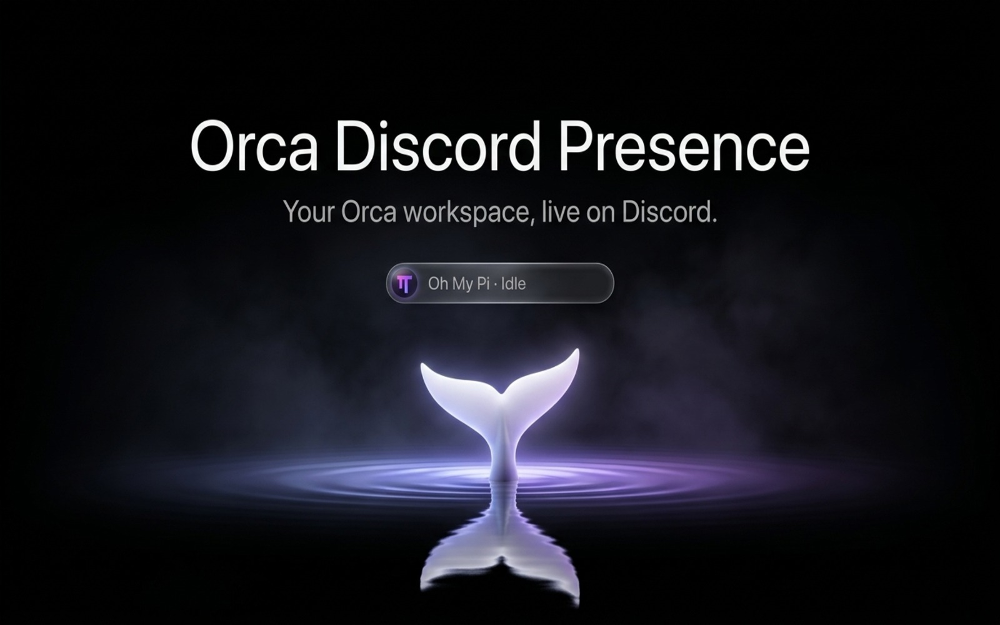
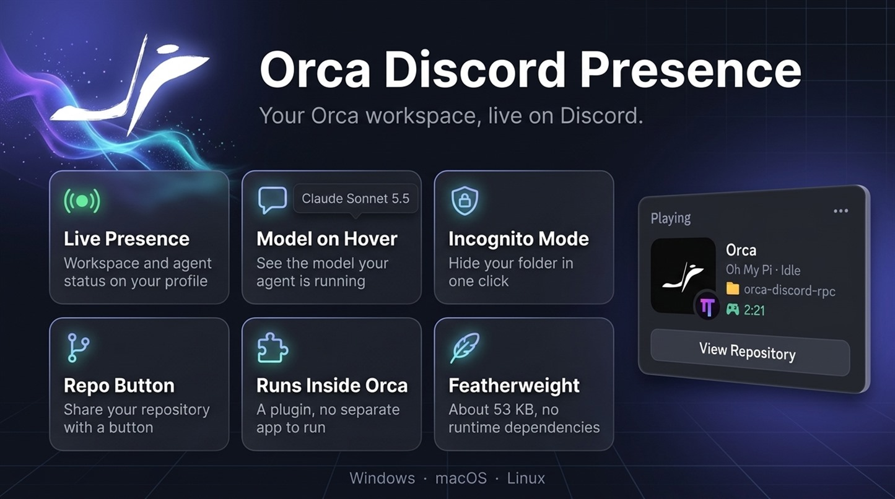
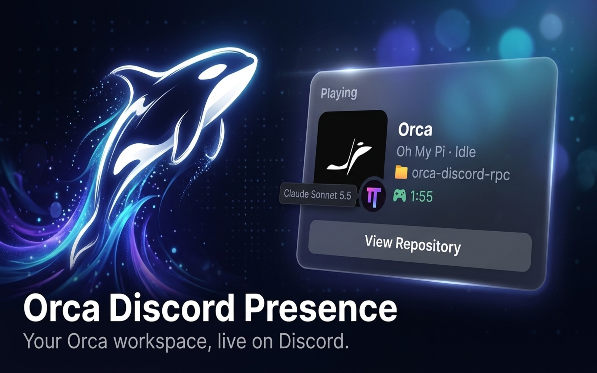
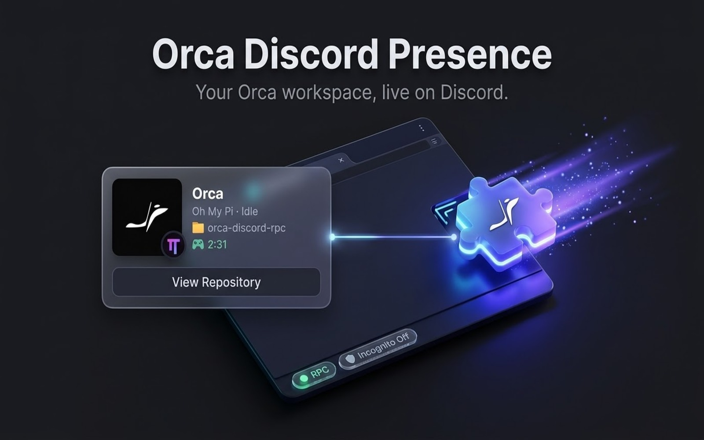
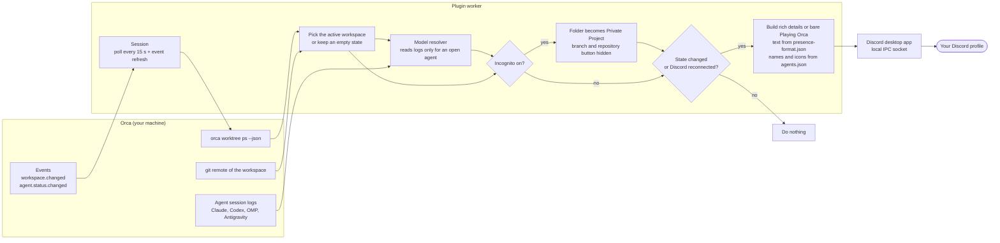
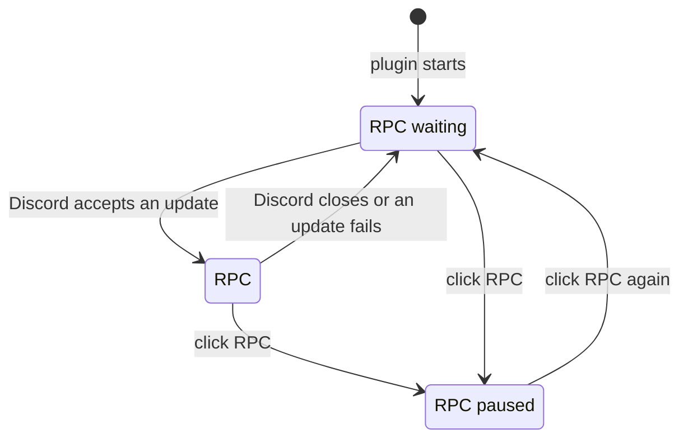

# Orca Discord Presence



Shows your active [Orca](https://github.com/stablyai/orca) workspace and coding agent on your Discord profile.

The plugin is TypeScript bundled to JavaScript. It runs in Orca's built-in Node.js worker on Windows, macOS, and Linux and starts with Orca. You need no separate app, no Node.js install, and no terminal command.

## Preview

These are illustrations of the plugin, not captures from a live session. Real cards vary with your Discord version and theme.







## Install

You need Orca 1.4.250 or newer, plus the Discord desktop app running and logged in. Discord in a browser cannot connect to the plugin.

1. Open Settings > Plugins in Orca and turn on plugins if needed.
2. Click Add Plugin and choose a Git source.
3. Enter `https://github.com/meryzennn/orca-discord-rpc.git#v0.3.0`. The [tags page](https://github.com/meryzennn/orca-discord-rpc/tags) lists newer versions.
4. Check that Orca resolves the tag you entered.
5. Read Orca's worker access prompt, approve it, and enable the plugin.

The worker asks for `workspace:read`, `agent:read`, and `settings:own`. It reads workspace information and local agent session files, then sends presence updates to Discord.

A tag URL stays on the same code until you change it. `#main` gives you the latest commit, which can change at any time, including what Discord shows.

Run one presence provider at a time. Before you install, stop any older one: the headless daemon, a development plugin, or the Windows exe (see [Migrating from the Windows exe](#migrating-from-the-windows-exe)).

## Use

With RPC enabled, Orca stays visible on Discord while the app is open. Without an active workspace or an open agent, the card shows Playing Orca and the continuing elapsed timer, with no project, model, custom artwork or button. Discord may still show its normal application icon. Open an agent to show its details; an idle agent keeps its Idle status. Presence follows workspace, agent and model changes, polling every 15 seconds by default.

The same start timestamp is sent in every view, so leaving a workspace or closing the last agent does not reset playtime. Pausing RPC or closing Orca ends that session. Updating or restarting the plugin starts a new session.

The status bar has these controls:

| Control | What it does |
| --- | --- |
| `RPC` | Presence is connected. Click to pause. |
| `RPC paused` | Click to resume. |
| `RPC waiting` | Discord is unavailable or the last update failed. Hover for the reason. |
| `Incognito On` / `Incognito Off` | Click to change privacy without opening Settings. |
| `Update RPC` | Check and update the installed Git plugin using Orca 1.4.253 or newer. |
| `Updating RPC` | The update request is running. Presence and its controls stay available. |
| `RPC up to date` / `RPC updated` / `RPC pinned` | The updater's result. Hover for the version or next step; click to check again. |
| `Update error` | Hover for the reason, such as an older Orca version or an update needing review. |

Incognito replaces your folder with `Private Project` and hides the repository button. Your agent and model stay visible. If you change Incognito while paused, presence stays paused and the new setting applies when you resume.

Privacy changes do not reload the plugin or restart the Playing timer. Closing Orca or disabling the plugin stops the worker and presence.

## How it works

The plugin runs inside Orca's worker. Every poll (and every `workspace.changed` or `agent.status.changed` event) it reads your active workspace and builds a Discord activity. It sends an update when the state changes or Discord reconnects. A valid reading without an active workspace or agent still produces a bare Playing Orca activity.



The status bar item follows a small state machine:



Presence updates use the local connection to Discord. Clicking Update RPC asks Orca's updater and Git to contact the plugin's source repository; the plugin does not download or replace its own files.

## Updates

Starting with v0.3.0, click **Update RPC** in the status bar or run **Discord RPC: Update installed plugin** from the command palette. This requires the **Orca application 1.4.253 or newer**. Presence still works on Orca 1.4.250, but its update button explains that the application needs upgrading.

The button runs Orca's updater for the published Git installation, `meryzennn.discord-presence`. A version-tag installation follows the newest version tag; a branch installation follows its newest commit. A commit pin stays pinned. Development folders keep their own source and must be removed or disabled before using the Git installation.

Install v0.3.0 once through Settings > Plugins > Add Plugin with `https://github.com/meryzennn/orca-discord-rpc.git#v0.3.0` to get the button. You do not need to uninstall the same Git plugin first. Review the new update command when Orca asks. Future updates with the same access keep their approval; updates requesting new access wait for review in Settings > Plugins. The button never approves extra access for you.

An installed update restarts the worker and starts a new elapsed session. An up-to-date check or a refused update leaves the running presence alone. Checks happen when you click; this plugin does not poll for updates or install them in the background. Orca's automatic update policy applies to pinned catalog releases, which this direct Git installation does not use.

## Migrating from the Windows exe

`OrcaPresence.exe` (v0.1.9 and earlier) does not move to the plugin on its own, and it gets no further updates. To switch:

1. Quit it from the tray icon.
2. In its folder, run `OrcaPresence.exe autostart disable` to remove the Windows startup entry.
3. Delete the folder.
4. Install the plugin (see [Install](#install)).

Two providers at once make your presence flip between two states, so run only one.

Your `config.json` carries over: the plugin reads the same file, so `clientId`, `pollMs`, and `useUploadedArt` keep working. Environment overrides set with `setx ORCA_DISCORD_*` stop working, because Orca scrubs them from plugin workers. Move them into `config.json`. The plugin copies your old Incognito choice once, and only when Orca has no saved Incognito value.

## What Discord shows

With one active agent, the two lines look like this:

```text
Oh My Pi · Working
📁 your-project
```

An idle agent shows `Idle`. A `+1` after the agent name counts the other open agent panes: `Oh My Pi +1 · Working`. The status sits on line 1 so narrow Discord popouts still show it.

| Field | Normal mode | Incognito |
| --- | --- | --- |
| Line 2 | `📁` and the active workspace name | `📁 Private Project` |
| Small icon | Featured agent | Same |
| Icon tooltip | Current model, when detected; otherwise the agent name | Same |
| Repository button | Workspace's Git `origin`, when valid | Hidden |
| Timer | Current session duration | Same |

An agent registry supplies names, icons, and model lookup. It has built-in entries for Codex, Claude Code, Oh My Pi, Antigravity, and other common agents, plus any `agents` entries you add. An agent without an entry still works (see [Adding a new agent](#adding-a-new-agent)).

Model lookup supports Codex, Claude Code, Oh My Pi, and Antigravity. The plugin reads their saved session metadata for the workspace. OMP and Antigravity record model changes apart from replies, so the plugin picks up a change on the next poll. Auxiliary usage, such as a judge model, does not replace the conversation model. When the plugin cannot read a model, the tooltip shows the agent name.

Agent icons use public image URLs by default. Uploaded Discord artwork is optional (see [Settings](#settings)).

## Settings

Orca stores pause/resume and Incognito in the plugin's settings, and the status bar controls and Settings stay in sync. At first startup the plugin copies an old `config.json` Incognito value only when Orca has no saved value.

For a custom Discord application, a different polling interval, or uploaded artwork, edit `config.json`:

| OS | File |
| --- | --- |
| Windows | `%LOCALAPPDATA%\orca-discord-rpc\config.json` |
| macOS | `~/Library/Application Support/orca-discord-rpc/config.json` |
| Linux | `~/.config/orca-discord-rpc/config.json` |

For example:

```json
{
  "pollMs": 15000,
  "useUploadedArt": false
}
```

- `clientId`: your own Discord application's id, as a string. Without it the plugin uses the built-in application.
- `pollMs`: at least 5000. A smaller or invalid value falls back to 15000.
- `useUploadedArt`: set to `true` only after you upload the `orca`, `git-branch`, and agent assets to your Discord application. The keys are the `asset` values in [config/agents.json](config/agents.json).
- `agents`: names an agent, gives it artwork, or chooses its model lookup. See [Adding a new agent](#adding-a-new-agent).

Reload the plugin after you edit the file. Incognito changes from the status bar need no reload.

Orca scrubs shell environment overrides from workers, so configure the plugin in the file, not through `ORCA_DISCORD_*`, `CODEX_HOME`, `CLAUDE_CONFIG_DIR`, or `PI_CODING_AGENT_DIR`. That includes `setx ORCA_DISCORD_CLIENT_ID` values from the old Windows app.

## Adding a new agent

Orca reports every agent by id. A new id needs no code change and no rebuild. The plugin shows a name made from the id (`new-agent` becomes `New Agent`), the Orca icon, and the agent name as the icon tooltip. It logs the unknown id once, in the plugin's logs in Settings (the headless daemon writes `daemon.log`).

To set a name, icon, or model lookup, add an entry under `agents` in `config.json`. Every field is optional and merges over the built-in entry with the same id:

```json
{
  "agents": {
    "new-agent": {
      "name": "New Agent",
      "imageUrl": "https://example.com/new-agent.png",
      "asset": "newagent",
      "modelResolver": "codex"
    }
  }
}
```

| Field | Meaning |
| --- | --- |
| `name` | Text shown on line 1, and in the tooltip when no model is known. |
| `imageUrl` | A public `https` image that Discord can fetch. Used when `useUploadedArt` is off. `http` and loopback addresses do not render. |
| `asset` | An asset key uploaded to your Discord application. Used only when `useUploadedArt` is `true`. |
| `modelResolver` | How to find the model: `claude`, `codex`, `omp`, or `antigravity`. Each reads that agent's saved session files. |

The built-in entries are in [config/agents.json](config/agents.json). Reload the plugin after you edit `config.json`. The plugin ignores an invalid entry or field and logs it once; the rest still applies.

Model lookup has limits. Orca does not report models, so the plugin reads saved sessions, and only the four layouts above exist. Set `modelResolver` only for an agent that writes the same files as one of them. Any other agent shows its name in the tooltip.

## Troubleshooting

| Problem | Check |
| --- | --- |
| No readable `orca-plugin.json` | For Git installs, use a URL ending in `.git#v0.3.0` or `.git#main`. For local installs, select the folder that holds `orca-plugin.json`, not its `plugin` subfolder. |
| `RPC waiting` | Open Discord desktop and wait for the next poll. If it persists, open the plugin's logs in Settings and check the RPC operation and error code. |
| `RPC paused` | Click RPC to resume. Switching Incognito does not resume paused presence. |
| No activity | Check that Orca and Discord desktop are open, the plugin is enabled, RPC is not paused, and Discord activity visibility is enabled. A workspace or agent is not required. |
| Agent name instead of a model | Check that the agent has a saved session for this workspace. Agents without a model resolver always show their name. |
| New agent shows a generated name and the Orca icon | The plugin has no entry for the id Orca reported. Add it under `agents` in `config.json` (see [Adding a new agent](#adding-a-new-agent)). |
| Missing icon | Discord may not render the public image. Use uploaded artwork with the matching asset keys. |
| Missing repository button | The workspace needs a valid web-compatible Git `origin`. Incognito hides the button. |
| Presence changes unexpectedly | Stop any running headless daemon or duplicate development plugin. |

OMP lookup uses the standard `~/.omp/agent/sessions` layout. The plugin does not find custom profiles, custom `--session-dir` paths, or XDG-relocated OMP state.

## RAM and CPU

The current plugin uses Node built-ins for Discord IPC and has no npm runtime dependencies. A controlled comparison on Windows used the same Orca executable, a Ryzen 5 5500, and 12 logical CPUs. Both bundles were imported into isolated workers with presence paused, without Discord connections or workspace polling:

| Metric | Previous SDK bundle | Minimal IPC bundle |
| --- | --- | --- |
| Bundle size | 1,400,511 bytes | 52,927 bytes |
| Total working set | 136.5 MiB | 123.4 MiB |
| Private bytes | 42.1 MiB | 28.9 MiB |
| Private working set | 31.5 MiB | 19.5 MiB |

These numbers predate the agent registry and text format. The bundle is now about 63 KB, still with no npm runtime dependencies. The memory figures have not been re-measured.

The empty host worker in the same run used 125.2 MiB total working set, 31.0 MiB private bytes, and 21.3 MiB private working set. Startup and garbage collection vary between processes, so treat these as observations, not a memory floor or a promise about every machine.

Total working set includes shared runtime pages. Private bytes are committed memory; private working set counts resident pages exclusive to the process. Do not read the total as entirely additional, unique RAM.

A previous 30-second sample of the active SDK-based worker measured about 135 to 137 MiB total working set, with average CPU near 0.06% of total CPU capacity. Active usage of the new IPC build still needs a separate measurement. The tables exclude Orca, Discord, and short-lived polling children.

To poll less often, raise `pollMs`, for example to `30000`. That reduces periodic CLI work, not the worker's steady runtime footprint. Pausing RPC leaves the worker loaded; disable the plugin to make the worker exit.

## Node headless daemon

For scripted use, install Node.js 24 or newer and make Orca's CLI available on `PATH`. On Linux, run these commands from an Orca-managed terminal so `orca` resolves to Orca's CLI and not the GNOME screen reader:

```sh
git clone https://github.com/meryzennn/orca-discord-rpc.git
cd orca-discord-rpc
npm ci
npm start
```

Run `npm run status` to check it and `npm stop` to stop it. Its text matches the plugin's: both build the lines from the same format definition and agent registry. Only the icon layout differs: a large agent/model icon plus a small branch icon. It reads the same configuration file and honours supported environment overrides.

To update a headless checkout from v0.3.0 onward:

```sh
node src/cli.ts update
```

It requires a repository-root checkout with no tracked edits and runs `git pull --ff-only` against its configured upstream. It restarts an existing daemon only when the checkout changed. An up-to-date check, failed pull, or local edits leave the daemon running; a stopped daemon stays stopped. For an older checkout, pull once and restart the daemon to get this command.

## Development

See [Development and testing](docs/DEVELOPMENT.md) for build commands, clean plugin snapshots, and the manual acceptance checklist.

Automated payload, lifecycle, typecheck, and bundle checks do not cover real Orca and Discord rendering. The repository runs a Windows, macOS, and Linux CI matrix; live behaviour on each OS needs its own validation.

## License

[MIT](LICENSE).
